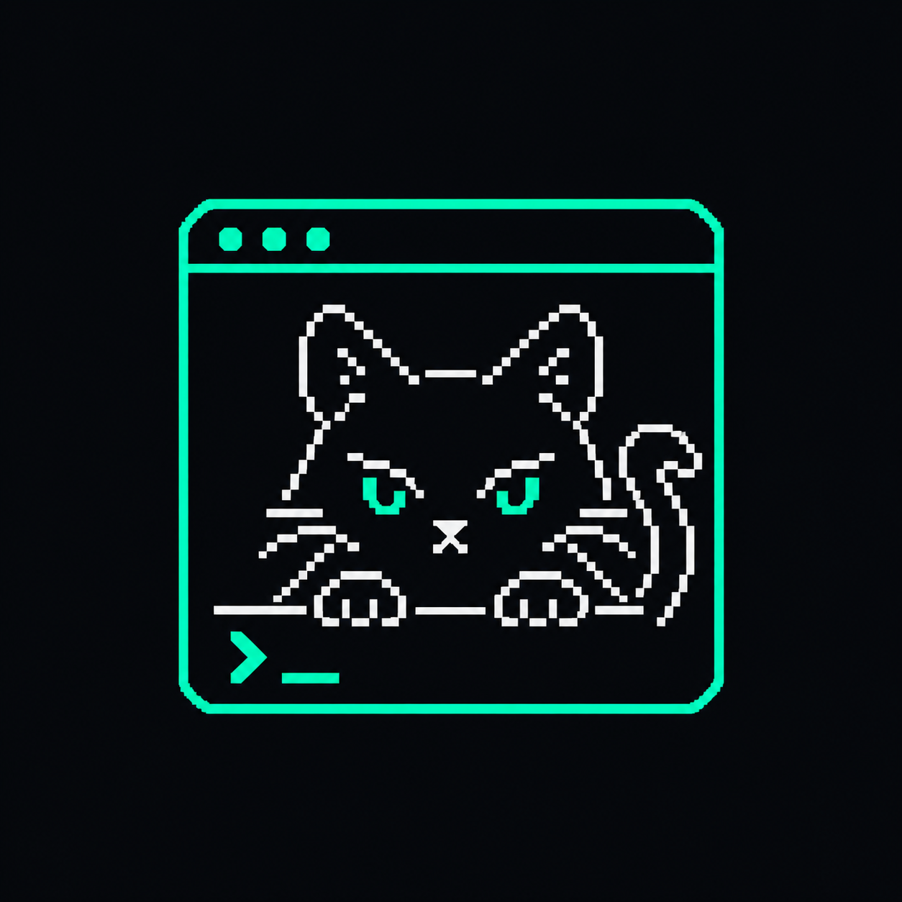
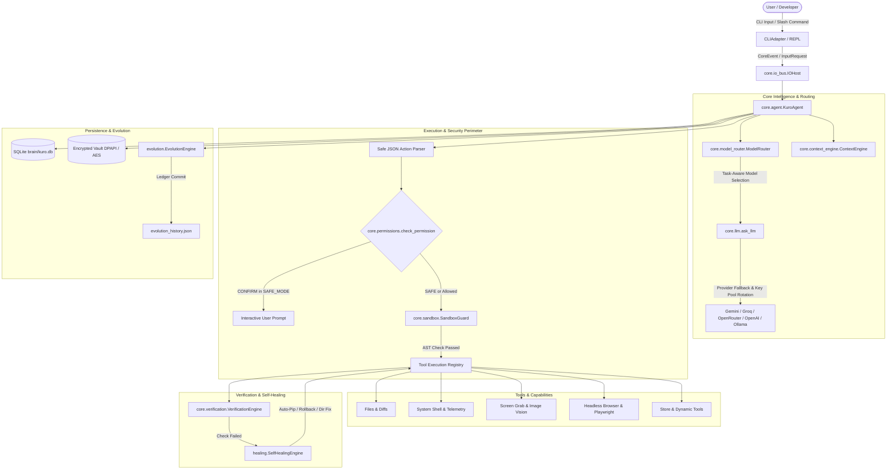

<div align="center">


# ⚡ KURO 2.0 (`kurocode`)
### *The Autonomous, Local-First AI Terminal Assistant & Operating System Copilot*

[](https://www.python.org/)
[](https://github.com/kurolabs-ai/KuroCodeAgent)
[](LICENSE)
[](docs/architecture/KURO_2.0_MASTER_SPECIFICATION.md)
[](src/kurocode/security/)

<br/>

<br/>
<br/>

**KURO** is an autonomous desktop terminal agent designed to think, plan, execute, verify, heal, and evolve directly on your machine.
Unlike passive AI chat widgets, KURO has hands: it compiles code, executes shell commands, inspects live PC telemetry, captures screenshots, automates browsers, heals its own errors, and installs plug-and-play tools on the fly.

[Key Features](#-key-features) • [Architecture](#-system-architecture) • [Quickstart](#-quickstart--installation) • [CLI Orders & Slash Commands](#-cli-orders--slash-commands) • [Security & Vault](#-security-sandboxing--vault) • [Self-Healing & Evolution](#-self-healing--evolution) • [Store & Plugins](#-puzzle-store--modular-extensibility)

</div>

---

## 🚀 Key Features

<table>
<tr>
<td width="50%">

### 🧠 Autonomous ReAct Execution Loop
* **Multi-Step Problem Solving**: Decomposes complex high-level goals into ordered execution plans.
* **Deterministic Verification**: Never assumes success. Validates every action via AST compilation (`py_compile`), file presence, and exit code analysis.
* **Multi-Provider Cascade**: Automatic zero-downtime failover between **Gemini**, **Groq**, **OpenRouter**, **OpenAI**, and local **Ollama**.

</td>
<td width="50%">

### 🩺 Autonomous Self-Healing Subsystem
* **Failure Classifier**: Inspects errors across 10 structured categories (`MISSING_DEPENDENCY`, `SYNTAX_ERROR`, `FILESYSTEM_ERROR`, etc.).
* **Automated Remediation**: Triggers automated `pip install`, recursive directory reconstruction, or file snapshot rollbacks.
* **Safe Checkpointing**: Automated Git stash snapshots before file edits for instant `/undo`.

</td>
</tr>
<tr>
<td width="50%">

### 🔒 Enterprise-Grade Security & Sandboxing
* **Windows DPAPI Native Vault**: Encrypts API keys and secrets tied to the current OS user profile (`CryptProtectData`) with zero cleartext leaks.
* **AST Safety Analyzer**: Statically analyzes Python code to block malicious imports (`_ctypes`, `winreg`) and dangerous calls (`shutil.rmtree`).
* **PII & Token Masking**: Automatically scrubs sensitive credentials and API tokens from all terminal logs and outputs.

</td>
<td width="50%">

### 🧩 Puzzle Store & Runtime Tool Authoring
* **Plug-and-Play Marketplace**: One-click install/remove modular tools, plugins, procedural skills, and integrations.
* **Dynamic Tool Generator**: KURO can write new Python tools for itself, validate them in a sandbox, and hot-load them at runtime without restarting.
* **Online Hub Sync**: Seamlessly syncs capabilities with remote community hubs (`kuroLabs-ai/hub`).

</td>
</tr>
<tr>
<td width="50%">

### 👁️ Multimodal Perception & Automation
* **Desktop Vision**: Captures screenshots of your monitor to diagnose UI glitches, charts, and error popups.
* **Web Automation**: Headless browser scraping and Playwright script execution (`click`, `fill`, `press`).
* **Hardware Telemetry**: Monitors live CPU cores, RAM consumption, and disk storage metrics.

</td>
<td width="50%">

### 🌐 Unified External Service Bridges
* **Smart Notifications**: Multi-channel alerts sent to **Discord** (rich embed cards) and **Telegram** (bot & channels with photos).
* **Developer Bridges**: Native integration connectors for **GitHub**, **GitLab**, and **Google Drive**.

</td>
</tr>
</table>

---

## 🏛️ System Architecture

KURO 2.0 separates presentation, orchestration, domain capabilities, and storage into clean, decoupled layers:



---

## ⚡ Quickstart & Installation

### 1. Prerequisites
* **Python**: 3.10, 3.11, 3.12, or 3.13
* **Git**: Installed and available in PATH (for automatic checkpointing)
* **OS**: Windows (optimal, with full DPAPI vault support), Linux, or macOS

### 2. Clone & Setup Virtual Environment
```bash
# Clone the repository
git clone https://github.com/kurolabs-ai/KuroCodeAgent.git
cd KuroAgent

# Create and activate virtual environment
python -m venv .venv

# On Windows:
.venv\Scripts\activate
# On Linux / macOS:
source .venv/bin/activate

# Upgrade pip & install package in editable development mode
python -m pip install --upgrade pip setuptools wheel
pip install -e .
```

### 3. Configure API Keys
You can configure API keys in two ways:

#### Option A: Interactive In-App Command (Recommended)
Launch KURO and use the built-in `/key` command to securely store your keys into the encrypted vault:
```bash
kuro
# Inside KURO:
/key gemini AIzaSyYourGeminiApiKeyHere
/key groq gsk_YourGroqApiKeyHere
```

#### Option B: Environment File (`.env`)
Create a `.env` file in the project root:
```env
# Primary LLM Providers
GEMINI_API_KEY=your_gemini_api_key_here
GROQ_API_KEY=your_groq_api_key_here
OPENROUTER_API_KEY=your_openrouter_api_key_here
OPENAI_API_KEY=your_openai_api_key_here

# Agent Execution Tuning
KURO_PROVIDER=gemini
KURO_MAX_STEPS=10
KURO_SAFE_MODE=true
KURO_GIT_CHECKPOINTS=true
```

---

## 💻 Operating Modes

### Interactive REPL Mode
Experience the complete terminal interface with dark themes, autocomplete, syntax highlighting, and live spinners:
```bash
kuro
# or
python main.py
```

### Headless Single-Shot Mode
Execute single commands directly from CI/CD pipelines, background scripts, or terminal workflows:
```bash
# Direct task execution
kuro "Analyze the git status and list modified files"

# Output structured JSON for automation
kuro --json "Check database schema and table names"
```

---

## 🎮 CLI Orders & Slash Commands

KURO's interactive terminal REPL provides a streamlined, clutter-free Tab menu containing essential system, security, KuroHub, and skill commands:

```
┌────────────────────────────────────────────────────────────────────────┐
│                        KURO 2.0 COMMAND CENTER                         │
└────────────────────────────────────────────────────────────────────────┘
```

### ⚙️ System & Configuration
| Command | Usage / Example | Description |
| :--- | :--- | :--- |
| **`/status`** | `/status` | Displays active provider, model, loaded key counts, Safe Mode, and checkpoint status. |
| **`/system`** | `/system` | Displays live hardware telemetry: CPU logical cores, RAM utilization, and disk storage stats. |
| **`/top`** | `/top [limit]` | Scans active operating system processes ordered by memory footprint. |
| **`/safe`** | `/safe <on\|off\|toggle\|allow <tool>\|clear>` | Configures permission gate. `/safe on` requires approval for file writes; `/safe allow run_command` whitelists a tool. |
| **`/pool`** | `/pool` | Displays live multi-key pool rotation status, active keys, and HTTP 429 rate-limit cooldown timers. |
| **`/models`** | `/models [provider]` | Displays priority fallback model chains for the active provider. |
| **`/key`** | `/key [provider] <KEY>` | Securely saves an API key to the active provider pool and commits it to the encrypted vault. |
| **`/undo`** | `/undo` | Rolls back the last automated file changes using Git stash checkpoints. |
| **`!<cmd>`** | `!git status` or `!dir` | **Direct Shell Bypass**: Executes locally in OS shell without calling LLM. |

### 🧩 KuroHub & Capabilities
| Command | Usage / Example | Description |
| :--- | :--- | :--- |
| **`/hub`** | `/hub [list\|search <q>\|install <item>\|remove <item>\|update]` | Browse and manage capabilities in KuroHub (tools, plugins, skills, integrations). |
| **`/store`** | `/store search crypto` or `/store install json_inspector` | Alias for KuroHub store manager. |
| **`/skills`** | `/skills` | Lists all installed and self-learned procedural skills in `skills.json`. |
| **`/<skill> [prompt]`** | `/<skill-name> <custom instructions>` | Directly executes an installed procedural skill with LLM guidance and parameters. |
| **`/plugin`** | `/plugin [list\|install <source>\|remove <name>]` | Manages modular plugins (installed as complete folders into `plugins/`). |
| **`/integrations`**| `/integrations [connect <service> <token>\|disconnect <service>]` | Manages external service bridges (Telegram, Discord, GitHub, Google Drive). |

### 🧠 Memory, Vault & Session
| Command | Usage / Example | Description |
| :--- | :--- | :--- |
| **`/vault`** | `/vault [status\|list\|set\|get\|delete\|lock\|unlock]` | Manages Windows DPAPI / AES-256 encrypted credential vault. |
| **`/memory`** | `/memory` | Inspects stored episodic conversation memories and context summaries from SQLite. |
| **`/clear`** | `/clear` | Clears active conversation memory for a clean workspace. |
| **`/help`** | `/help` | Displays the categorized command reference. |
| **`exit / quit`** | `exit` or `quit` | Terminates the active KURO session. |

> **Autonomous Execution:** Capabilities such as web searching, headless browsing, multimodal image inspection, code execution, planning, note taking, and self-healing error recovery are orchestrated autonomously by Kuro without cluttering the slash menu.

---

## 🔒 Security, Sandboxing & Vault

KURO adheres to a strict principle of least privilege:

```
┌────────────────────────────────────────────────────────┐
│               KURO SECURITY PERIMETER                  │
├────────────────────────────────────────────────────────┤
│  1. Central Permission Gate                            │
│     • Actions classified: SAFE, CONFIRM, DANGEROUS     │
│     • Destructive actions blocked unless confirmed     │
├────────────────────────────────────────────────────────┤
│  2. Encrypted Credential Vault                         │
│     • Windows DPAPI (CryptProtectData) zero-leak       │
│     • PBKDF2-HMAC-SHA256 (200,000 iterations) fallback │
│     • Credentials masked in memory (sk-12...cdef)      │
├────────────────────────────────────────────────────────┤
│  3. AST Execution Sandbox Guard                        │
│     • Banned imports: _ctypes, winreg, msvcrt          │
│     • Dangerous call detection: shutil.rmtree, popen   │
│     • Destructive shell regex: format, rm -rf, del /s  │
├────────────────────────────────────────────────────────┤
│  4. Automated Git Checkpoint Safety Net                │
│     • Auto-stash snapshot before file writes           │
│     • Instant rollback via /undo                       │
└────────────────────────────────────────────────────────┘
```

---

## 🩺 Self-Healing & Evolution

### The Self-Healing Loop
When a tool fails during autonomous execution, the **Self-Healing Engine** (`kurocode.healing`) takes over:
1. **Detection**: `FailureDetector` matches stack traces against 10 error categories (`MISSING_DEPENDENCY`, `SYNTAX_ERROR`, `FILESYSTEM_ERROR`, `NETWORK_ERROR`, etc.).
2. **Diagnosis**: `FailureDiagnostician` calculates confidence and formulates a repair hypothesis.
3. **Automated Repair**:
   * *Missing Package*: Executes `pip install <missing_module>` and retries.
   * *Syntax Error*: Restores previous working file snapshot and retries with AST linting.
   * *Filesystem Error*: Recursively creates missing directory paths.
   * *Network / 429*: Pauses with exponential backoff and cascades to secondary provider.

### Controlled Capability Evolution
KURO audits its own performance over time (`kurocode.evolution`):
* Detects recurring failure patterns in `brain/kuro.db`.
* Analyzes user requests for unsupported capability keywords (`cannot do`, `missing tool`).
* Synthesizes formal `ImprovementProposal` records with unique proposal IDs.
* Tests and validates newly synthesized skills in an isolated workspace before deploying to production.
* Tracks all milestones in an append-only ledger (`evolution_history.json`).

---

## 🧩 KuroHub & Modular Capability Architecture

KURO manages capabilities as modular, plug-and-play **puzzle pieces**:
* **Tools**: Discrete callable functions saved as individual `.py` files in `tools/` and registered in `brain/tools.json`.
* **Plugins**: Full modular capability packages installed as complete directory trees into `plugins/` and registered in `brain/plugins.json`.
* **Skills**: Multi-step procedural routines installed as directory trees into `skills/` and registered in `brain/skills.json`.
* **Integrations**: Connected service bridges installed into `integrations/` and registered in `brain/integrations.json`.

### Direct Procedural Skill Invocation (`/<skill-name>`)
Installed skills are dynamically loaded into your Tab autocompletion menu. When invoked via:
```bash
/<skill-name> [prompt or parameters]
# Example:
/git-release-workflow bump version to 2.1.0 and run tests
```
KURO automatically loads the skill instructions from `skills/<name>/SKILL.md` (or `README.md`), composes the execution plan with your prompt, and executes the routine step-by-step with deterministic verification.

### The KuroLabs Capability Hub (`kuroLabs-ai/hub`)
KURO is natively integrated with the official community registry at [`https://github.com/kuroLabs-ai/hub`](https://github.com/kuroLabs-ai/hub):
* **Live Hub Sync**: Run `/hub update` to fetch the latest capability registry (`kuro-hub.json`).
* **One-Click Installation**: Install community puzzle pieces directly via `/hub install <name>` or `/store install <name>`.
* **Clean File Placement**: Tools install cleanly as single `.py` files into `tools/`, while plugins, skills, and integrations install as self-contained folders into `plugins/`, `skills/`, and `integrations/`.
* **Contribution & Publishing**: Author custom capabilities with `/hub publish` or contribute directly by opening pull requests to [`kuroLabs-ai/hub`](https://github.com/kuroLabs-ai/hub).

---

## 🏗️ Building Standalone Binaries

KURO includes a build pipeline to compile a standalone executable distribution:

```bash
# Build standalone console application (dist/KuroConsole/KuroConsole.exe)
python build/build_exe.py

# Package Windows Installer via Inno Setup (requires ISCC installed)
build\build_installer.bat
```

The resulting binary runs without requiring Python to be installed on the host machine, cleanly separating application binaries from user data in `%APPDATA%\Kuro`.

---

## 🧪 Testing & Verification

Run the test suite across units, integrations, and capabilities:

```bash
# Run complete test suite
pytest -v

# Run targeted test suites
pytest tests/test_advanced_capabilities.py
pytest tests/test_evolution.py
pytest tests/test_store_marketplace.py
```

---

## 📄 License & Credits

Distributed under the **MIT License**. See `LICENSE` for details.

* **Created by:** [Akira Omran](https://github.com/Abdo-omran2206)
* **Architecture:** KURO 2.0 Level 2 Autonomous System Assistant
* **Repository:** [https://github.com/kurolabs-ai/KuroCodeAgent](https://github.com/kurolabs-ai/KuroCodeAgent)
