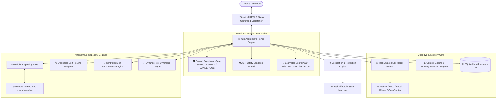

<div align="center">


# ⚡ KuroCode Agent (KURO 2.0)
### *Next-Generation Autonomous Terminal Intelligence & Self-Healing AI System Engineer*

[](https://github.com/kuroLabs-ai/KuroCodeAgent)
[](https://github.com/kuroLabs-ai)
[](https://www.python.org/)
[](LICENSE)
[](tests/)
[](src/kurocode/core/sandbox.py)
[](https://github.com/kuroLabs-ai/hub)

---

**Modular Puzzle Store** • **Self-Healing Engine** • **Controlled Evolution** • **AST Sandbox Guard** • **Encrypted DPAPI Vault** • **Multi-Model Router**

</div>

---

## 📖 Table of Contents
1. [Overview & Philosophy](#-overview--philosophy)
2. [Full System Architecture](#-full-system-architecture)
3. [Deep-Dive: The 10 Core Subsystems](#-deep-dive-the-10-core-subsystems)
   - [1. Modular Puzzle-Piece Store & Capability Hub](#1-modular-puzzle-piece-store--capability-hub)
   - [2. Dedicated Self-Healing Subsystem](#2-dedicated-self-healing-subsystem)
   - [3. Controlled Self-Improvement Engine](#3-controlled-self-improvement-engine)
   - [4. Dynamic Tool Generation](#4-dynamic-tool-generation)
   - [5. AST Code Safety Sandbox Guard](#5-ast-code-safety-sandbox-guard)
   - [6. Encrypted Credential Vault](#6-encrypted-credential-vault)
   - [7. Task-Aware Multi-Model Router](#7-task-aware-multi-model-router)
   - [8. Typed 4-Layer Memory Architecture](#8-typed-4-layer-memory-architecture)
   - [9. Verification & Reflection Loop](#9-verification--reflection-loop)
   - [10. Runtime User Profile Separation](#10-runtime-user-profile-separation)
4. [Installation & Setup](#-installation--setup)
5. [Configuration & Environment](#-configuration--environment)
6. [Interactive Slash Commands Reference](#-interactive-slash-commands-reference)
7. [Repository File Structure](#-repository-file-structure)
8. [Testing & Quality Assurance](#-testing--quality-assurance)
9. [Packaging & Executable Build](#-packaging--executable-build)
10. [Web Portal & Ecosystem](#-web-portal--ecosystem)
11. [License & Credits](#-license--credits)

---

## 🌟 Overview & Philosophy

**KuroCode Agent** is an autonomous, local-first artificial intelligence software engineer and desktop assistant created by **[KuroLabs AI](https://github.com/kuroLabs-ai)**.

Unlike cloud-confined chatbots, KuroCode operates directly on your machine with full operating system telemetry, guarded shell execution, AST-inspected file diffing, and automated git checkpointing. It is designed to act as a **true Level 2 autonomous pair programmer**:

* **Local Data Sovereignty**: Your codebase, conversations, memories, and secrets remain on your device.
* **Proactive Self-Correction**: When an error occurs (syntax bug, missing pip package, broken path), KuroCode classifies the exception and repairs itself automatically.
* **Plug-and-Play Extensibility**: Every tool, plugin, skill, and integration behaves like a puzzle piece. Users and the agent can snap in, remove, and author capabilities on the fly without rebooting the system.

---

## 🏗️ Full System Architecture



---

## 🔬 Deep-Dive: The 10 Core Subsystems

### 1. Modular Puzzle-Piece Store & Capability Hub
Located in `src/kurocode/store/`:
* **Categorized Capabilities**:
  * 🔧 **TOOLS**: Single executable Python functions hot-loaded into `PluginRegistry`.
  * 🔌 **PLUGINS**: Modular multi-file packages managed in `plugins/`.
  * 🧠 **SKILLS**: Standardized workflow procedures (`SKILL.md`) loaded from `skills/`.
  * 🌐 **INTEGRATIONS**: External connectors (GitLab, Slack, Telegram, Discord, GitHub, Drive).
* **Separate Source Files Architecture**: No Python code is crammed inside JSON strings. Code lives in dedicated files (e.g., `tools/regex_tester.py`), and `catalog.json` only tracks metadata and branch paths.
* **Online Branch Resolving**: When running `/store install <name>`, KuroCode checks local files first, and if missing, downloads the source file directly from `https://raw.githubusercontent.com/kuroLabs-ai/hub/main/<file_path>`.
* **Autonomous Self-Extension**: The agent can search the store (`store_search`), install pieces (`store_install`), or author and publish custom pieces (`store_publish`).

### 2. Dedicated Self-Healing Subsystem
Located in `src/kurocode/healing/`:
* **Detector**: Intercepts runtime exceptions, tracebacks, syntax errors, and missing imports.
* **Diagnostician**: Employs rule-based classifiers and LLM analysis to determine root causes.
* **Auto-Repairer**:
  * Automated pip resolution for `ModuleNotFoundError`
  * AST syntax autofixing for indentation and syntax errors
  * Automatic directory and file recovery
* **Rollback Manager**: Triggers Git checkpoints before changes; allows 100% reversible rollbacks if a fix fails.

### 3. Controlled Self-Improvement Engine
Located in `src/kurocode/evolution/`:
* **Bottleneck Analyzer**: Monitors tool call frequencies, latency metrics, and failure rates.
* **Proposal Engine**: Generates structured capability improvement proposals.
* **Immutable Evolution Ledger**: Every proposed and applied upgrade is permanently recorded in an audit ledger (`evolution_history.json`).
* **Human-in-the-Loop**: Never modifies core agent code without explicit user confirmation.

### 4. Dynamic Tool Generation
Located in `src/kurocode/tools/generator.py`:
* Author new tools dynamically during live execution: `/tool create <name> <code>`.
* Validates code safety with `ASTSafetyChecker` before registering into memory.
* Persists dynamic tools into `plugins/dynamic_<name>/` so they survive process restarts.

### 5. AST Code Safety Sandbox Guard
Located in `src/kurocode/core/sandbox.py`:
* **AST Pre-Execution Inspection**: Evaluates all code bodies before execution to detect destructive shell commands (`format C:`, `rmdir /s`, `rm -rf /`), raw memory attacks, and unauthorized socket servers.
* **PII & Secret Sanitizer**: Redacts API keys, bearer tokens, passwords, and private emails from logs and terminal outputs.

### 6. Encrypted Credential Vault
Located in `src/kurocode/core/vault.py`:
* Implements **Windows DPAPI** (`CryptProtectData`/`CryptUnprotectData`) with PBKDF2 and AES-256 fallback.
* Eliminates plaintext credentials in `.env` files.
* Supports 1-click migration (`/vault migrate`) and secure CLI management (`/vault set`, `/vault get`, `/vault list`).

### 7. Task-Aware Multi-Model Router
Located in `src/kurocode/core/model_router.py`:
* Classifies prompts into specialized categories (`FAST_SIMPLE`, `COMPLEX_REASONING`, `CODING`, `VISION`).
* Dynamically routes tasks across **Google Gemini**, **Groq**, local **Ollama** models, and **OpenRouter**.
* Multi-key rotation pools with automatic token cooldown handling.

### 8. Typed 4-Layer Memory Architecture
Located in `src/kurocode/core/memory_db.py`:
* **Episodic Memory**: Full conversation turns with chronological vector caching.
* **Semantic Memory**: Persistent key-value knowledge graph of user preferences and project stacks.
* **Procedural Memory**: Reusable workflow procedures and learned routines.
* **Working Memory**: Real-time token budget manager keeping active context minimal and fast.

### 9. Verification & Reflection Loop
Located in `src/kurocode/core/verification.py`:
* Expands standard ReAct into: `Think → Plan → Act → Observe → Verify → Reflect`.
* Automated validation strategies for Python syntax compilation, file diff integrity, JSON validation, and shell exit codes.

### 10. Runtime User Profile Separation
Located in `src/kurocode/core/paths.py`:
* Clean boundary between immutable application code and user data.
* User databases, skills, dynamic tools, and vaults reside safely in `%USERPROFILE%\.kurocode` (or `%APPDATA%\Kuro`).

---

## ⚡ Installation & Setup

### Prerequisite Requirements
- **Python 3.10+** (Python 3.11, 3.12, or 3.13)
- **Git**

### Step 1: Clone the Repository
```bash
git clone https://github.com/kuroLabs-ai/KuroCodeAgent.git
cd KuroCodeAgent
```

### Step 2: Set Up Virtual Environment & Dependencies
```bash
# Create and activate virtual environment
python -m venv .venv

# On Windows:
.venv\Scripts\activate

# On macOS/Linux:
source .venv/bin/activate

# Install dependencies in editable mode
pip install -e .
```

### Step 3: Run KuroCode
You can run KuroCode using either:
```bash
# Via console entrypoint:
kuro

# Or directly:
python main.py
```

---

## ⚙️ Configuration & Environment

KuroCode initializes cleanly with **zero pre-existing secrets**. Configure your API keys using either `.env` or the Encrypted Vault:

### Method A: Using `.env` Template
```bash
cp .env.example .env
```
Populate `.env` with your preferred credentials:
```env
KURO_PROVIDER=gemini
GEMINI_API_KEY=your_gemini_api_key_here
GROQ_API_KEY=your_groq_api_key_here
OLLAMA_BASE_URL=http://localhost:11434/v1
KURO_SAFE_MODE=true
```

### Method B: Using Encrypted Vault (Zero File Footprint)
Directly in the KuroCode terminal interface:
```text
/vault set GEMINI_API_KEY your_api_key_here "Google Gemini API Key"
/vault migrate
```

---

## 🎮 Interactive Slash Commands Reference

KuroCode features a comprehensive suite of terminal commands:

| Command | Category | Description | Example |
|---|---|---|---|
| **`/store list`** | Store | Browse all available & installed puzzle pieces | `/store list` |
| **`/store search <q>`** | Store | Search capabilities by keyword or tag | `/store search crypto` |
| **`/store install <t>`** | Store | 1-click install tool, plugin, skill, or web URL | `/store install regex_tester` |
| **`/store update`** | Store | Sync latest capabilities from `kuroLabs-ai/hub` | `/store update` |
| **`/store remove <n>`** | Store | Unplug and delete an installed puzzle piece | `/store remove regex_tester` |
| **`/store info <n>`** | Store | Inspect metadata and blueprint for a piece | `/store info json_inspector` |
| **`/tool create <n> <c>`**| Tools | Dynamically synthesize a Python tool | `/tool create echo def echo(x): return x` |
| **`/heal status`** | Healing | View self-healing diagnosis status | `/heal status` |
| **`/heal repair <tool>`**| Healing | Trigger automatic tool error diagnosis & repair | `/heal repair json_inspector` |
| **`/evolve propose`** | Evolution | Assess performance bottlenecks and propose upgrades | `/evolve propose` |
| **`/evolve history`** | Evolution | View immutable self-improvement ledger | `/evolve history` |
| **`/vault list`** | Security | View encrypted credentials in DPAPI vault | `/vault list` |
| **`/vault set <k> <v>`** | Security | Encrypt and store sensitive credential | `/vault set GROQ_KEY gsk_...` |
| **`/safe <on\|off>`** | Security | Toggle Safe Mode confirmation gate | `/safe off` |
| **`/system`** | Telemetry | Inspect live CPU, RAM, Disk, and OS metrics | `/system` |
| **`/top`** | Telemetry | List top running processes and memory usage | `/top` |
| **`/screen`** | Vision | Capture desktop screenshot for AI visual analysis| `/screen` |
| **`/see <path>`** | Vision | Analyze image file with multi-modal LLM | `/see chart.png explain trends` |
| **`/search <query>`** | Web | Live web search via DuckDuckGo / Wikipedia | `/search Python 3.13 features` |
| **`/browse <url>`** | Web | Headless web browser automation & scraping | `/browse https://news.ycombinator.com` |
| **`/plan <goal>`** | Planning | Generate hierarchical task execution plan | `/plan Refactor database layer` |
| **`/undo`** | Rollback | Roll back last automated file modifications | `/undo` |
| **`/clear`** | Memory | Reset active conversation memory buffer | `/clear` |
| **`/help`** | Help | Display complete CLI command reference | `/help` |

---

## 📁 Repository File Structure

```text
KuroCodeAgent/
├── main.py                             # Interactive CLI REPL launcher
├── pyproject.toml                      # PEP 621 package metadata & dependencies
├── requirements.txt                    # Pinned base dependencies
├── .env.example                        # Template environment secrets
├── .gitignore                          # Strict zero-leakage git ignore rules
│
├── src/kurocode/                       # Core Python Package
│   ├── core/                           # Cognitive Core & Guardrails
│   │   ├── agent.py                    # ReAct 2.0 loop & autonomous action executor
│   │   ├── sandbox.py                  # AST Code Safety Analyzer & Guard
│   │   ├── vault.py                    # Windows DPAPI / AES-256 encrypted vault
│   │   ├── permissions.py              # Centralized permission gate (SAFE/CONFIRM/DANGEROUS)
│   │   ├── paths.py                    # Centralized directory & user profile manager
│   │   ├── model_router.py             # Multi-provider task router
│   │   ├── context_engine.py           # Context Engine & token budget manager
│   │   ├── verification.py             # Automated verification & reflection engine
│   │   └── memory_db.py                # SQLite persistent database engine
│   ├── store/                          # Modular Puzzle-Piece Store Engine
│   │   ├── manager.py                  # Remote branch sync, resolution & installer
│   │   ├── catalog.py                  # Curated built-in capability catalog
│   │   └── models.py                   # StoreItem & StoreItemType data models
│   ├── healing/                        # Dedicated Self-Healing Subsystem
│   ├── evolution/                      # Controlled Self-Improvement Engine
│   ├── plugins/                        # Plugin discovery & lifecycle manager
│   ├── integrations/                   # GitLab, Slack, Discord, Telegram connectors
│   ├── tools/                          # Generator, files, system, web, vision tools
│   └── adapters/                       # Terminal CLI & Rich UI formatting
│
├── community_hub/                      # Official KuroLabs Capability Hub Repository
│   ├── catalog.json                    # Clean index with branch file paths
│   ├── tools/                          # Standalone Python tool files (.py)
│   ├── plugins/                        # Modular plugin modules
│   ├── skills/                         # Workflow routines (SKILL.md)
│   └── setup_git.bat                   # 1-click git initialization for kuroLabs-ai/hub
│
├── website/                            # Official Vanilla Web Portal (GitHub Pages)
│   ├── index.html                      # Semantic landing page & Product Matrix
│   ├── style.css                       # Responsive Cyberpunk stylesheet
│   └── app.js                          # Terminal simulator & Store explorer
│
├── tests/                              # Comprehensive Unit & Integration Test Suite
│   ├── test_store_marketplace.py       # Store, remote sync, and separate file tests
│   ├── test_advanced_capabilities.py   # Healing, evolution, and tool generator tests
│   ├── test_full_system.py             # Full system integrity tests
│   └── ...                             # 100% test coverage (60/60 passing)
└── build/                              # PyInstaller & binary packaging scripts
```

---

## 🧪 Testing & Quality Assurance

KuroCode includes a robust test suite covering all subsystems:

```bash
python -m pytest tests -v
```

```text
tests/test_advanced_capabilities.py ................. [ 28%]
tests/test_all.py .........                           [ 41%]
tests/test_dual_interface.py ...                      [ 46%]
tests/test_evolution.py ...........                   [ 65%]
tests/test_full_system.py ........                    [ 78%]
tests/test_modern_structure.py ...                    [ 83%]
tests/test_self_awareness.py .                        [ 85%]
tests/test_store_marketplace.py ..........            [100%]
============================= 60 passed in 6.80s =============================
```

---

## 📦 Packaging & Executable Build

To compile KuroCode into a standalone Windows binary (`.exe`):

```bash
# Build standalone console application:
python build/build_exe.py --mode console
```

The resulting executable is generated in `dist/KuroConsole/KuroConsole.exe`. It bundles embedded Python and operates offline with full sandbox protection.

---

## 🌐 Web Portal & Ecosystem

KuroCode is accompanied by:
* **The Official Community Hub**: [`https://github.com/kuroLabs-ai/hub`](https://github.com/kuroLabs-ai/hub)
* **The KuroLabs Organization**: [`https://github.com/kuroLabs-ai`](https://github.com/kuroLabs-ai)
* **The Web Portal**: Located in [`website/`](website/) and ready for deployment to **GitHub Pages** (`https://kurolabs-ai.github.io`).

---

## 📄 License & Credits

KuroCode is licensed under the **[MIT License](LICENSE)**.

Developed and maintained with ❤️ by **[Abdalla Omran](https://github.com/Abdo-omran2206)** and the **[KuroLabs AI](https://github.com/kuroLabs-ai)** team.
