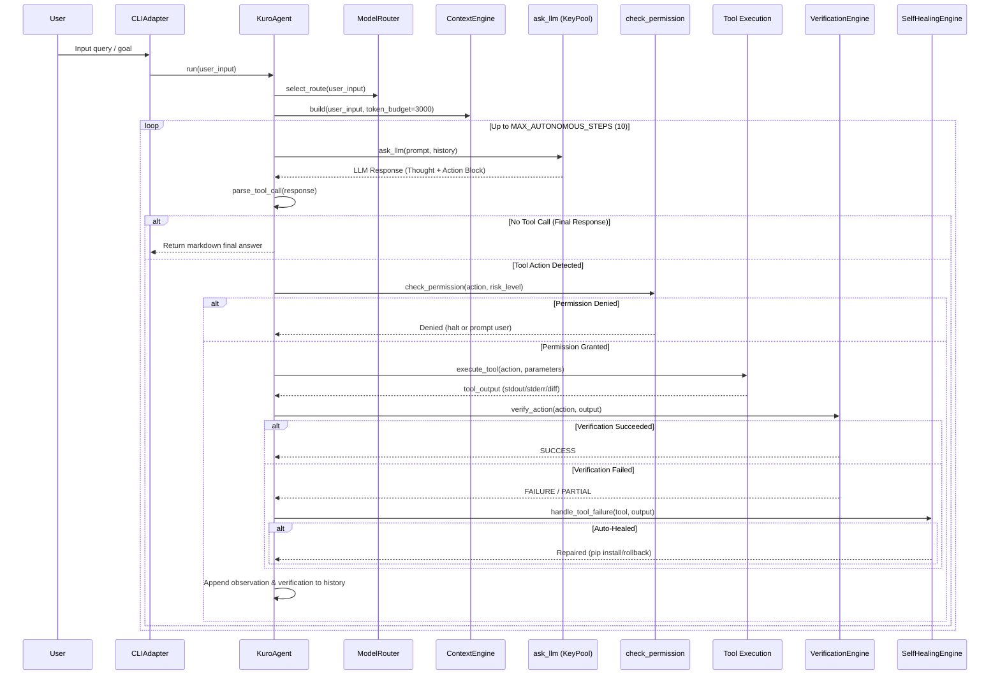
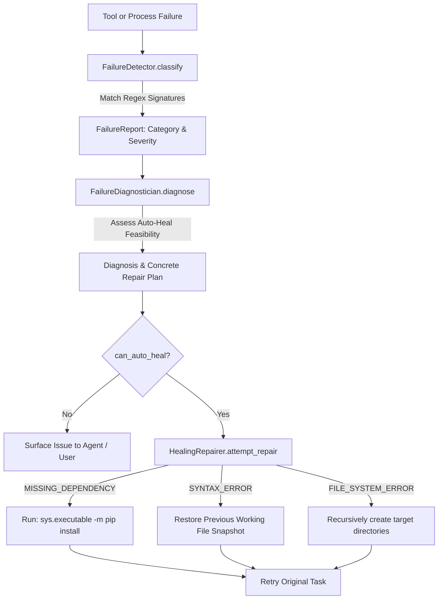

# KURO 2.0 (`kurocode`) — Comprehensive Technical Architecture & Master Specification

> **Document Type:** Comprehensive Architectural Specification & Source Code Deep Dive  
> **Package:** `kurocode` (v0.2.0)  
> **Target OS:** Windows / Cross-Platform  
> **Entry Points:** `main.py`, `src/kurocode/cli/app.py`  
> **Author / Maintainer:** Akira Omran  

---

## Table of Contents
1. [Executive Summary & Core Philosophy](#1-executive-summary--core-philosophy)
2. [Global Architecture & Execution Topography](#2-global-architecture--execution-topography)
3. [Bootstrapping & Presentation Layer](#3-bootstrapping--presentation-layer)
   - `main.py` & `kurocode.cli.app`
   - `kurocode.adapters.cli.CLIAdapter`
   - Complete Slash Command (`/`) & Shell Order Reference
4. [Agent Core & Autonomous ReAct Engine](#4-agent-core--autonomous-react-engine)
   - `kurocode.core.agent.KuroAgent`
   - Autonomous ReAct Execution Flow (Step-by-Step)
   - JSON Action Parser & Fallback Extraction
   - The Central Permission Gate (`kurocode.core.permissions`)
5. [Model Routing, Key Pools & LLM Cascade](#5-model-routing-key-pools--llm-cascade)
   - Multi-Provider Cascade & Failover Sequence
   - Key Pool Rotation & Rate-Limit Cooling (HTTP 429)
   - Heuristic Task Routing (`kurocode.core.model_router`)
6. [Context Engineering & Memory Architecture](#6-context-engineering--memory-architecture)
   - Priority-Budgeted Context Engine (`kurocode.core.context_engine`)
   - Four-Tier Memory System (`kurocode.core.memory_types`)
   - SQLite Database Schema & Persistence (`kurocode.core.memory_db`)
7. [Security, Sandboxing & Credential Vault](#7-security-sandboxing--credential-vault)
   - Windows DPAPI & PBKDF2 Credential Vault (`kurocode.core.vault`)
   - AST Code Safety Guard & PII Sanitizer (`kurocode.core.sandbox`)
   - Path Traversal & Destructive Shell Defenses
8. [Perception, Web & Automation Tooling](#8-perception-web--automation-tooling)
   - Filesystem Tools & Automated Unified Diffs (`kurocode.tools.files`)
   - System Telemetry & Process Monitor (`kurocode.tools.system`)
   - Git Checkpoints & Rollbacks (`kurocode.tools.git_checkpoint`)
   - Vision & Screen Capture (`kurocode.tools.vision`)
   - Headless & Playwright Web Browsing (`kurocode.tools.web_browser`)
   - Multi-Channel Smart Notifications (`kurocode.tools.notifier`)
9. [Self-Healing Engine](#9-self-healing-engine)
   - Failure Detection & Categorization (`kurocode.healing.detector`)
   - Root-Cause Diagnostician (`kurocode.healing.diagnostician`)
   - Automated Repair Workflows & Rollbacks (`kurocode.healing.repairer`)
10. [Controlled Evolution & Self-Improvement](#10-controlled-evolution--self-improvement)
    - Bottleneck & Capability Analyzer (`kurocode.evolution.analyzer`)
    - Proposal Formulation (`kurocode.evolution.improver`)
    - Sandboxed Skill Synthesis & Testing (`kurocode.evolution.generator` & `tester`)
    - Evolution Ledger (`kurocode.evolution.versioning`)
11. [Extensibility: Store, Plugins & Integrations](#11-extensibility-store-plugins--integrations)
    - Capability Marketplace (`kurocode.store.manager` & `catalog`)
    - Dynamic Tool Generator (`kurocode.tools.generator`)
    - Plugin System & Hot-Loading (`kurocode.plugins.manager`)
    - External Service Connectors (`kurocode.integrations`)
12. [Packaging, Build System & Environment Setup](#12-packaging-build-system--environment-setup)
    - Path Resolution: Dev vs Frozen (`kurocode.core.paths`)
    - PyInstaller & Inno Setup Deployment (`build/build_exe.py`)

---

## 1. Executive Summary & Core Philosophy

**KURO 2.0 (`kurocode`)** is an autonomous, local-first artificial intelligence assistant, terminal workspace, and system automation platform. It is designed to operate directly on the user's local operating system with strong guardrails, deterministic self-verification, robust self-healing, and controlled capability expansion.

Unlike standard conversational chatbots that simply emit code snippets, KURO:
1. **Acts Directly**: Executes terminal commands, reads and mutates local project files, automates web browsers, queries SQLite databases, and captures monitor screens.
2. **Never Assumes Success**: Evaluates every tool execution through an independent **Verification Strategy Engine** (inspecting exit codes, verifying file sizes, running Python AST syntax checks via `py_compile`).
3. **Self-Heals**: Intercepts syntax breaks, missing dependencies, or missing filesystem paths, diagnosing the root cause and automatically running repairs (e.g., executing `pip install`, creating directory structures, or reverting changes via Git snapshots).
4. **Guards Security**: Mediates all system side-effects through a centralized permission layer with AST safety analysis, destructive shell command blocking, and Windows DPAPI credential encryption.
5. **Evolves Under Control**: Analyzes its own execution logs to detect repeated task failures or missing tools, formulating formal improvement proposals and authoring dynamic Python tools and skills that hot-load without restarting the process.

---

## 2. Global Architecture & Execution Topography

The platform is structured into decoupled layers communicating via an event-driven I/O Bus:

```
┌────────────────────────────────────────────────────────────────────────┐
│                        PRESENTATION LAYER                              │
│   • Interactive REPL (Rich + Prompt-Toolkit)                           │
│   • Headless Runner (--query / --json)                                 │
│   • 30+ Slash Commands (/status, /safe, /vault, /heal, /store, etc.)   │
└───────────────────────────────────┬────────────────────────────────────┘
                                    │ CoreEvent / InputRequest
                                    ▼
┌────────────────────────────────────────────────────────────────────────┐
│                          I/O BUS (`io_bus`)                            │
│   • UI-Agnostic Event Dispatcher (Progress, Logs, Thoughts, Prompts)   │
│   • Cancellation Token Support (Ctrl+C Graceful Interrupt)             │
└───────────────────────────────────┬────────────────────────────────────┘
                                    │
                                    ▼
┌────────────────────────────────────────────────────────────────────────┐
│                       CORE RE-ACT AGENT LOOP                           │
│                                                                        │
│   [Task Registry] ──▶ Assigns ID, states: PENDING ➔ EXECUTING          │
│   [Model Router]  ──▶ Evaluates query type (Coding/Vision/Reasoning)   │
│   [Context Engine]──▶ Assembles prioritized token-budgeted memory      │
│   [LLM Dispatch]  ──▶ Pool Rotation & Provider Cascade (Gemini/Groq/..│
│   [Action Parser] ──▶ Regex fallback + JSON extractor                  │
│                                   │                                    │
│             ┌─────────────────────┴─────────────────────┐              │
│             ▼                                           ▼              │
│   [Permission Gate]                           [Sandbox Guard]          │
│   • SAFE / CONFIRM / DANGEROUS                • AST Banned Calls       │
│   • Auto Git Checkpoint                       • PII / Key Sanitizer    │
│             │                                           │              │
│             └─────────────────────┬─────────────────────┘              │
│                                   ▼                                    │
│                       [Tool Execution Engine]                          │
│        (Shell, Files, DB, Web, Browser, Vision, Custom Plugins)        │
│                                   │                                    │
│             ┌─────────────────────┴─────────────────────┐              │
│             ▼                                           ▼              │
│   [Verification Engine]                       [Self-Healing Engine]    │
│   • AST syntax check                          • Detector (10 classes)  │
│   • File presence & diffs                     • Auto-Pip / Auto-Rollback│
│   • Command exit codes                        • Git Stash restore      │
│             │                                           │              │
│             └─────────────────────┬─────────────────────┘              │
│                                   ▼                                    │
│   [Memory & Ledger] ──▶ Commit conversation, tasks, metrics, skills    │
└────────────────────────────────────────────────────────────────────────┘
```

---

## 3. Bootstrapping & Presentation Layer

### 3.1 Entry Point Flow
Execution begins in [`main.py`](file:///d:/vscode/Kuro.worktrees/kurocode/main.py) which delegates immediately to [`kurocode.cli.app:run`](file:///d:/vscode/Kuro.worktrees/kurocode/src/kurocode/cli/app.py).

```python
# main.py
from kurocode.cli.app import run, main
if __name__ == "__main__":
    main()
```

#### Windows Encoding & Environment Fixups
Before initializing libraries like `rich` or `prompt_toolkit`, `cli.app` applies essential platform safeguards:
* `PYGAME_HIDE_SUPPORT_PROMPT = "1"` suppresses third-party library noise.
* Sets `UNICODE_VERSION = "15.1.0"` to avoid character width calculation crashes.
* Forces Windows standard output and error buffers into UTF-8 mode via `reconfigure(encoding="utf-8", errors="replace", line_buffering=True)`.

#### Launch Modes (`kurocode.core.launch`)
* **Headless Single-Shot Mode (`--query` / positional strings)**:
  Instantiates `KuroAgent()`, passes the prompt directly to `cli.run_headless()`, prints results (or JSON if `--json` is supplied), and exits with status 0.
* **Interactive REPL Mode (`kuro` with no arguments, or `--cli`)**:
  Spawns `CLIAdapter().run_interactive(agent)`, establishing a full prompt-toolkit loop with command history, auto-completion, live spinners, and multi-line markdown rendering.

---

### 3.2 The CLI Adapter (`kurocode.adapters.cli`)
The presentation layer is implemented in [`src/kurocode/adapters/cli.py`](file:///d:/vscode/Kuro.worktrees/kurocode/src/kurocode/adapters/cli.py).

#### Features:
1. **Dark High-Contrast Aesthetic**: Styled with cyan accents, rounded panels (`box.ROUNDED`), dynamic bottom toolbar showing current LLM Provider, Model, Safe Mode status, and key counts.
2. **Tab Completion (`KuroCompleter`)**: Dynamically autocompletes 30+ slash commands with inline descriptions, falling back to filesystem path autocompletion when inputs contain directory markers or follow `!` shell bypasses.
3. **Decoupled I/O Host (`CallbackHost`)**: The adapter hooks into `io_bus` to receive structured `CoreEvent` messages (`PROGRESS`, `TOOL`, `LOG`, `THOUGHT`, `NOTIFICATION`) without tight coupling to the agent logic.
4. **Cancellation Handlers**: Ctrl+C during agent execution triggers `host.request_cancel()`, instructing the loop to halt safely between tool calls rather than crashing the process.

---

### 3.3 Complete Slash Command (`/`) & Shell Order Reference

| Category | Command | Arguments | Behavior & Execution Flow |
| :--- | :--- | :--- | :--- |
| **Bypass** | `!<cmd>` | `<shell_command>` | **Direct Local Shell**: Bypasses LLM completely; executes command in local OS subprocess; renders stdout in green and stderr in red panels. |
| **Core** | `/status` | _none_ | Renders status banner: active provider, model, loaded keys, Safe Mode, Git checkpoint status. |
| **Core** | `/safe` | `status` \| `on` \| `off` \| `toggle` \| `allow <tool>` \| `clear` | **Permission Gate Control**: Toggles Safe Mode. `/safe on` requires interactive confirmation for destructive tools; `/safe allow <tool>` whitelists a tool. |
| **Core** | `/pool` | _none_ | Displays status of all provider key pools (total keys, active keys, cooling keys under HTTP 429). |
| **Core** | `/models` | _none_ | Displays the priority model fallback chain for the active provider. |
| **Core** | `/key` | `[provider] <KEY>` | Adds API key to provider pool and commits it into encrypted vault and `.env`. |
| **Core** | `/undo` | _none_ | Reverts the last automated file edit via `git checkout . && git clean -fd`. |
| **Perception** | `/system` | _none_ | Displays PC telemetry: OS version, logical CPU count, RAM usage, and primary storage space. |
| **Perception** | `/top` | `[limit]` | Lists running OS processes ordered by memory footprint. |
| **Perception** | `/screen` | _none_ | Takes a screenshot of the primary display via PIL or Windows PowerShell GDI. |
| **Perception** | `/open` | `<target>` | Launches desktop application or opens path/URL via default OS handler. |
| **Perception** | `/dir` | `[path]` | Lists directory contents, file types, and sizes with tab autocomplete. |
| **Perception** | `/project` | _none_ | Scans current directory and prints tech stack profile, entrypoints, and test commands. |
| **Perception** | `/notes` | `<file.md> <content>` | Writes structured markdown note into `brain/notes/`. |
| **Perception** | `/sql` | `<query>` | Executes raw SQL query against SQLite database (`brain/kuro.db`). |
| **Perception** | `/search` | `<query>` | Performs live web search via DuckDuckGo and Wikipedia scrapers. |
| **Perception** | `/see` | `<path> [prompt]` | Loads image, base64 encodes it, and sends it to multimodal vision LLM. |
| **Perception** | `/browse` | `<url>` | Headless browser: fetches URL, strips HTML noise, and extracts text and links. |
| **Perception** | `/notify` | `test` \| `diagnose` \| `config` \| `<msg>` | Dispatches alerts to Telegram or Discord with priority tiers, speech, or image attachments. |
| **Memory** | `/memory` | _none_ | Displays recent episodic conversation memories from SQLite. |
| **Memory** | `/clear` | _none_ | Wipes active conversation working memory. |
| **Memory** | `/plan` | `[goal]` | Decomposes goal into ordered multi-step execution plan table. |
| **Memory** | `/tasks` | _none_ | Shows task lifecycle history (`PENDING` $\to$ `EXECUTING` $\to$ `COMPLETED`). |
| **Memory** | `/metrics` | _none_ | Renders analytics table: duration, tool call count, token usage, and costs. |
| **Security** | `/vault` | `status` \| `list` \| `set` \| `get` \| `delete` \| `migrate` \| `lock` \| `unlock` | Manages DPAPI / AES-256 encrypted credential vault. `/vault migrate` pulls secrets from `.env`. |
| **Security** | `/sandbox` | `status` \| `on` \| `off` \| `toggle` \| `clean` \| `check <code>` | Manages AST execution guardrails; checks Python scripts for banned imports and destructive calls. |
| **Extensibility** | `/store` | `list` \| `search` \| `install` \| `remove` \| `info` \| `update` | Puzzle Store manager: search and install modular tools, plugins, skills, and integrations. |
| **Extensibility** | `/plugin` | `list` \| `install` \| `remove` | Manages external plugins from local paths or Git repositories. |
| **Extensibility** | `/skill` | `list` \| `install` \| `delete` | Manages procedural skill files from `skills/`. |
| **Extensibility** | `/tool` | `list` \| `create <name> <code>` | Dynamically compiles, AST-validates, and hot-loads custom Python tools. |
| **Extensibility** | `/learn` | `<name> <steps>` | Teaches KURO a new procedural workflow and saves it to learned skills. |
| **Extensibility** | `/skills` | _none_ | Lists all self-learned procedural skills. |
| **Extensibility** | `/integrations` | _none_ | Lists connection status for Telegram, Discord, GitHub, Drive, and GitLab. |
| **Extensibility** | `/connect` | `<service> <token> [user]` | Connects service token and saves it in the encrypted vault. |
| **Extensibility** | `/disconnect` | `<service>` | Revokes active service connection. |
| **Evolution** | `/heal` | `status` \| `repair <tool> [err]` | Inspects Self-Healing engine; triggers automated diagnosis, `pip install`, or syntax rollback. |
| **Evolution** | `/evolve` | `propose` \| `history` | Runs performance bottleneck analysis, proposes capability additions, and inspects evolution ledger. |
| **Session** | `/help` | _none_ | Displays categorized interactive command reference table. |
| **Session** | `exit` / `quit` | _none_ | Terminates session, flushes history to `.kuro_history`. |

---

## 4. Agent Core & Autonomous ReAct Engine

### 4.1 ReAct Loop Architecture (`kurocode.core.agent`)
The primary agent loop is implemented in [`src/kurocode/core/agent.py:KuroAgent`](file:///d:/vscode/Kuro.worktrees/kurocode/src/kurocode/core/agent.py). KURO operates via a structured **ReAct** (Reason, Act, Observe, Verify, Reflect) cycle:



---

### 4.2 Robust JSON Action Parsing
Because LLMs may produce malformed escape sequences or mix prose with JSON, `_safe_json_parse()` uses a three-tier extraction strategy:
1. **Direct Standard JSON Parsing**: Calls `json.loads(raw, strict=False)`.
2. **Escape Sequence Repair**: If an exception occurs, a regex replaces unescaped backslashes with double backslashes (`\import` $\to$ `\\import`, `\path` $\to$ `\\path`).
3. **Regex Key-Value Recovery**: As a fallback, regex extracts `"action"` and known parameters (`cmd`, `path`, `target`, `replacement`, `content`, `code`, `query`, `url`, `prompt`, `steps`, `db_path`) directly from the raw string.

---

### 4.3 Central Permission Gate (`kurocode.core.permissions`)
The permission system defines three explicit risk categories:

```python
class RiskLevel(Enum):
    SAFE      = "safe"       # Read-only, no side effects (read_file, list_dir, search_web, telemetry)
    CONFIRM   = "confirm"    # Impactful writes (write_file, edit_file, execute_python, run_command)
    DANGEROUS = "dangerous"  # High impact / destructive (delete_file, format drive, credential changes)
```

#### Gate Logic:
* When `config.SAFE_MODE = True`, any action classified as `CONFIRM` or `DANGEROUS` halts execution and prompts the user via `IOHost.request(InputRequest(kind="confirm"))`.
* In headless non-interactive mode, actions requiring confirmation fail immediately with a safety error rather than executing unmonitored.
* Individual tools can be permanently allowed via `/safe allow <action_name>`.

---

## 5. Model Routing, Key Pools & LLM Cascade

### 5.1 Provider Cascade & Multi-Key Pools (`kurocode.core.config` & `llm`)
KURO maintains a resilient provider cascade:
$$\text{Gemini} \longrightarrow \text{Groq} \longrightarrow \text{OpenRouter} \longrightarrow \text{OpenAI} \longrightarrow \text{Ollama (Local)}$$

Each provider is backed by a `KeyPool`:
* **Pool Rotation**: When an API key encounters an HTTP 429 (Rate Limit / Quota Exceeded), `KeyPool.mark_rate_limited(api_key, cooldown_seconds=60.0)` benches that key for 60 seconds and immediately selects the next available key.
* **Invalid Key Ejection**: HTTP 401/403 errors mark the key as invalid, removing it from active rotation.
* **Model Cascade**: Server errors (500, 502, 503, 504) or missing model errors (404) trigger immediate fallback to the next model in `MODEL_CHAINS[provider]`.

---

### 5.2 Heuristic Task Routing (`kurocode.core.model_router`)
Incoming user queries are analyzed using keyword and structural heuristics to select the most appropriate model:

```python
class TaskType(str, Enum):
    FAST_SIMPLE       = "fast_simple"       # Short summaries, listings -> lightweight models
    COMPLEX_REASONING = "complex_reasoning" # Multi-step architecture, debugging -> heavy reasoning models
    CODING            = "coding"            # Code synthesis, refactoring -> code-specialized models
    VISION            = "vision"            # Screenshots, diagrams -> multimodal models
```

* **Metrics Engine**: Tracks start time, total elapsed duration, token usage, tool call counts, retries, and estimated cost per task, persisting them to the `metrics` table in SQLite.

---

## 6. Context Engineering & Memory Architecture

### 6.1 Priority-Budgeted Context Engine (`kurocode.core.context_engine`)
To prevent context overflow and reduce costs, [`ContextEngine`](file:///d:/vscode/Kuro.worktrees/kurocode/src/kurocode/core/context_engine.py) selects only relevant information under a configurable token limit (default: 3,000 tokens):

| Priority | Section Name | Content | Eviction Behavior |
| :---: | :--- | :--- | :--- |
| **1** | `Current Goal` | The specific objective being executed | **Required** (Never dropped) |
| **2** | `Step Tool Results` | Output of the immediately preceding tool call | **Required** (Never dropped) |
| **3** | `Semantic Facts` | Project stack, dependencies, user preferences | Dropped last |
| **4** | `Recent Episodes` | Up to 4 recent conversation turns from history | Dropped second |
| **5** | `Relevant Skills` | Procedural workflows relevant to query | Dropped first if budget exceeded |

---

### 6.2 The Four-Tier Memory Model (`kurocode.core.memory_types`)
The memory architecture splits data into four distinct domains:
1. **Episodic Memory**: What happened? Interaction records with timestamps, user prompts, assistant answers, and summaries.
2. **Semantic Memory**: What does KURO know? Facts, project architectures, and preferences indexed by key and category with confidence scores.
3. **Procedural Memory**: How to do something? Step-by-step procedures, tool hints, pre-conditions, and historical success rates.
4. **Working Memory**: What is happening right now? Ephemeral task state, active steps, and intermediate findings.

---

### 6.3 SQLite Database Schema (`kurocode.core.memory_db`)
Persistent data is stored in `brain/kuro.db` using thread-safe SQLite connections (`check_same_thread=False` with a 10s timeout):

```sql
-- Conversations Table (Episodic)
CREATE TABLE IF NOT EXISTS conversations (
    id INTEGER PRIMARY KEY AUTOINCREMENT,
    timestamp REAL,
    user_text TEXT,
    assistant_text TEXT,
    summary TEXT,
    metadata TEXT
);

-- Semantic Memory Table
CREATE TABLE IF NOT EXISTS semantic_memory (
    id INTEGER PRIMARY KEY AUTOINCREMENT,
    key TEXT UNIQUE NOT NULL,
    value TEXT NOT NULL,
    category TEXT DEFAULT 'general',
    confidence REAL DEFAULT 1.0,
    source TEXT DEFAULT '',
    created_at REAL,
    updated_at REAL,
    tags TEXT DEFAULT '[]'
);

-- Task State Machine History
CREATE TABLE IF NOT EXISTS tasks (
    task_id TEXT PRIMARY KEY,
    goal TEXT NOT NULL,
    state TEXT NOT NULL,
    plan_json TEXT,
    steps_completed INTEGER DEFAULT 0,
    steps_total INTEGER DEFAULT 0,
    error TEXT,
    verification_result TEXT,
    retry_count INTEGER DEFAULT 0,
    created_at REAL,
    updated_at REAL
);

-- Execution Metrics & Cost Analytics
CREATE TABLE IF NOT EXISTS execution_metrics (
    id INTEGER PRIMARY KEY AUTOINCREMENT,
    task_id TEXT,
    provider TEXT,
    model TEXT,
    input_tokens INTEGER,
    output_tokens INTEGER,
    tool_calls INTEGER,
    retries INTEGER,
    duration_seconds REAL,
    success INTEGER,
    verification_result TEXT,
    estimated_cost REAL,
    created_at REAL
);

-- Plans & Skills Tables
CREATE TABLE IF NOT EXISTS plans (
    id TEXT PRIMARY KEY,
    title TEXT,
    goal TEXT,
    steps_json TEXT,
    status TEXT,
    created_at REAL,
    updated_at REAL
);
```

---

## 7. Security, Sandboxing & Credential Vault

### 7.1 Encrypted Credential Vault (`kurocode.core.vault`)
API keys, bot tokens, and webhooks are encrypted using a tiered cryptographic strategy:
1. **Windows DPAPI Native (`CryptProtectData`)**: On Windows, credentials are encrypted using the user's OS profile keys via `ctypes.windll.crypt32`. No cleartext keys are ever stored on disk.
2. **PBKDF2-HMAC-SHA256 & Keystream Cipher**: When a custom master password is set, keys are derived using 200,000 PBKDF2 iterations with random salting.
3. **In-Memory Masking**: Functions like `mask_secret("sk-1234567890abcdef")` ensure secrets are displayed as `sk-12...cdef` in terminal outputs and logs.

---

### 7.2 AST Code Safety Analyzer (`kurocode.core.sandbox`)
Before executing Python code via the dynamic tool generator or interpreter, the AST is scanned by `ASTSafetyVisitor`:
* **Banned Imports**: Blocks `_ctypes`, `winreg`, `msvcrt`.
* **Dangerous Call Patterns**: Flags or blocks `os.system`, `subprocess.Popen`, `shutil.rmtree`, and direct DLL bindings.
* **Destructive Shell Commands**: Matches regex patterns against `format [A-Z]:`, `rm -rf /`, `del /f /s`, `diskpart`, `mkfs`, and `shutdown`.
* **PII & Token Sanitizer**: Text outputs are scrubbed for OpenAI/Groq keys (`sk-...`), Gemini keys (`AIza...`), GitHub tokens (`ghp_...`), Discord webhooks, and Telegram bot tokens before display.

---

## 8. Perception, Web & Automation Tooling

### 8.1 Filesystem Tools & Diffs (`kurocode.tools.files`)
* `resolve_path()` converts relative paths to absolute paths under `Path.cwd()`.
* File write and edit operations calculate unified diffs using `difflib.unified_diff()`, surfacing changes to the terminal via the I/O bus.
* `execute_sql_query()` safely runs SQL commands, classifying read-only statements (`SELECT`, `PRAGMA`) vs schema-modifying writes.

### 8.2 Git Checkpoints & Rollbacks (`kurocode.tools.git_checkpoint`)
Before file modifications, KURO automatically snapshots the repository:
```bash
git stash push -u -m "kuro_checkpoint_<timestamp>"
git stash apply stash@{0}
```
If an edit fails verification, `/undo` executes `git checkout . && git clean -fd` to cleanly restore the working tree.

### 8.3 Vision & Screen Capture (`kurocode.tools.vision`)
* `analyze_image_tool()` validates image formats (`png`, `jpeg`, `webp`, `gif`), reading and encoding them to base64 for vision models.
* `capture_screen()` takes screenshots using PIL's `ImageGrab`, with an automated fallback to Windows PowerShell .NET GDI drawing routines if PIL is unavailable.

### 8.4 Web Browsing & Playwright (`kurocode.tools.web_browser`)
* `browse_web_headless()` fetches pages, strips scripts, styles, and SVG elements, extracting clean article body text and links.
* `automate_browser()` leverages `playwright.sync_api` to execute structured UI actions (`click`, `fill`, `press`), with an automatic fallback to `urllib` if Playwright is not installed.

### 8.5 Multi-Channel Notifications (`kurocode.tools.notifier`)
* Supports Discord webhooks with color-coded embed cards across 5 urgency levels (`INFO`, `SUCCESS`, `WARNING`, `CRITICAL`, `ALERT`).
* Supports Telegram Bot API with HTML formatting and image uploads.
* Connects directly to the encrypted vault for token storage.

---

## 9. Self-Healing Engine

Implemented in [`src/kurocode/healing/`](file:///d:/vscode/Kuro.worktrees/kurocode/src/kurocode/healing), the self-healing subsystem detects, diagnoses, and repairs runtime failures:



### Supported Error Categories:
1. `MISSING_DEPENDENCY`: Detects `ModuleNotFoundError` $\to$ automatically runs `pip install <module>`.
2. `SYNTAX_ERROR`: Detects invalid Python syntax $\to$ rolls back file edits to previous snapshot.
3. `FILE_SYSTEM_ERROR`: Detects missing paths $\to$ creates missing parent directories recursively.
4. `PROVIDER_ERROR`: Detects timeouts / 429s $\to$ pauses with exponential backoff and cascades to next provider.
5. `PERMISSION_DENIED`: Detects authorization halts $\to$ surfaces permission prompts to the user.

---

## 10. Controlled Evolution & Self-Improvement

KURO improves its own capabilities over time through a structured cycle:

1. **Analytical Audit (`evolution.analyzer`)**:
   Analyzes task history in SQLite to detect recurring failures (`repeated_failure`) or user requests containing phrases like *"cannot do"* or *"missing tool"* (`missing_tool`).
2. **Proposal Formulation (`evolution.improver`)**:
   Generates a formal `ImprovementProposal` with a unique ID (`PROP-XXXXXX`), target module, and proposed changes.
3. **Isolated Generation & Verification (`evolution.generator` & `tester`)**:
   Drafts new skills in a temporary workspace, runs validation checks, and only deploys to production `skills/` upon passing.
4. **Ledger Record (`evolution.versioning`)**:
   Appends every applied capability change to `evolution_history.json`.

---

## 11. Extensibility: Store, Plugins & Integrations

### 11.1 The Puzzle Store & Community Hub (`kurocode.store.manager` & `kuroLabs-ai/hub`)
KURO implements a decentralized, catalog-driven puzzle-piece store architecture. Rather than bloating the core runtime with domain-specific capabilities, tools, plugins, and procedural skills are cataloged in and retrieved from the official **KuroLabs Capability Hub** at [`https://github.com/kuroLabs-ai/hub`](https://github.com/kuroLabs-ai/hub).

* **Master Catalog Registry (`catalog.json`)**: Hosted on GitHub `main` branch (`https://raw.githubusercontent.com/kuroLabs-ai/hub/main/catalog.json`), indexing all verified capabilities (`tool`, `plugin`, `skill`, `integration`) with entrypoints, risk ratings, and dependencies.
* **On-Demand Synchronization (`/store update`)**: Queries the remote hub endpoint, parses the remote catalog payload, and merges community capabilities into the local store index at `%APPDATA%\Kuro\store_catalog.json`.
* **Hot-Loading & Assembly (`/store install <name>`)**: Downloads raw source files directly from GitHub (`tools/<name>.py`, `plugins/<name>/`, `skills/<name>/SKILL.md`), validates the Python AST against the sandbox guard, and hot-registers entrypoints into `PluginRegistry` without restarting the process.
* **Contributing & Publishing**: Developers can publish custom capabilities using `/store publish <name> <type> <desc>` or submit pull requests directly to `kuroLabs-ai/hub`.

### 11.2 Dynamic Tool Generator (`kurocode.tools.generator`)
Allows the agent to write its own tools at runtime:
1. Inspects proposed Python code with the AST Sandbox Guard.
2. Compiles code in an isolated module scope.
3. Registers the entrypoint function into `PluginRegistry`.
4. Persists the tool to `plugins/dynamic_<name>/tool.py`.

### 11.3 External Integrations (`kurocode.integrations`)
Modular connectors inherit from `BaseIntegration` to provide standard APIs:
* **Telegram**: Bot & channel messaging, media upload, HTML parsing, diagnostics.
* **Discord**: Webhook integration with embed formatting.
* **GitHub**: Repository management, pull requests, and commit inspections.
* **Google Drive**: File queries and uploads.
* **Email**: SMTP/IMAP communication bridges.

---

## 12. Packaging, Build System & Environment Setup

### 12.1 Path Resolution (`kurocode.core.paths`)
Resolves paths cleanly between development and frozen releases:
* `IS_FROZEN`: Detects PyInstaller runtime (`getattr(sys, "frozen", False)`).
* `APP_DIR`: In dev mode, resolves to the git repo root. In production, resolves to `sys.executable`'s directory.
* `USER_DATA_DIR`: Resolves to `%APPDATA%\Kuro` on Windows or `~/.kurocode`, ensuring user data, databases, and logs are kept separate from immutable application binaries.

### 12.2 Production Build Pipeline (`build/build_exe.py`)
Compiles the application into a standalone Windows distribution:
* **PyInstaller Bundling**: Compiles entrypoint `main.py` into `dist/KuroConsole/KuroConsole.exe`.
* **Data Ingestion**: Collects directories (`core`, `tools`, `integrations`, `adapters`, `brain`, `assets`, `config`, `skills`).
* **Hidden Imports**: Gathers runtime dependencies (`rich`, `prompt_toolkit`, `cryptography`, `edge_tts`, `pygame`, `speech_recognition`).
* **Inno Setup Script (`setup_installer.iss`)**: Generates a standard Windows installer executable with desktop shortcuts and uninstallation hooks.

---

## Summary

KURO 2.0 represents a modern, resilient architecture for autonomous terminal agents. By combining a flexible ReAct loop with strict verification strategies, automated self-healing, encrypted credential storage, and an extensible capability store, it provides a powerful, secure, and self-improving platform for local system automation.
